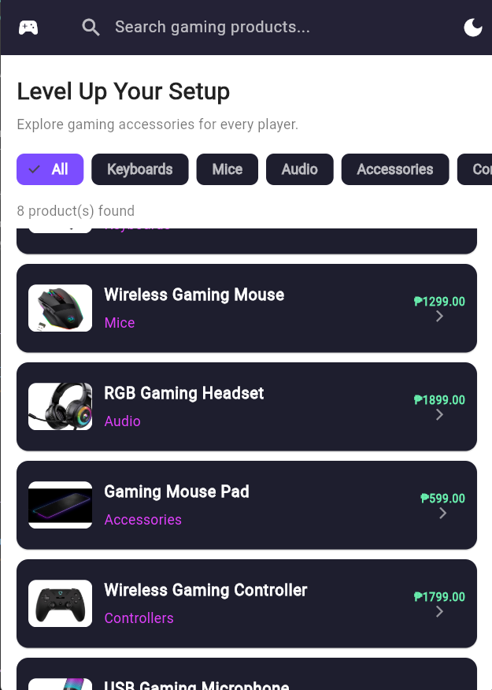
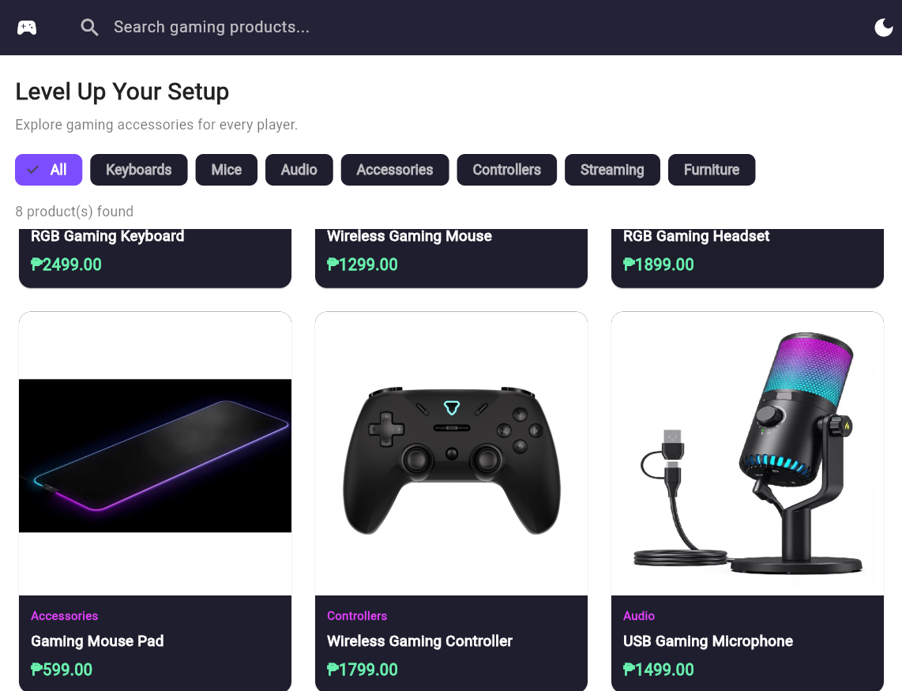
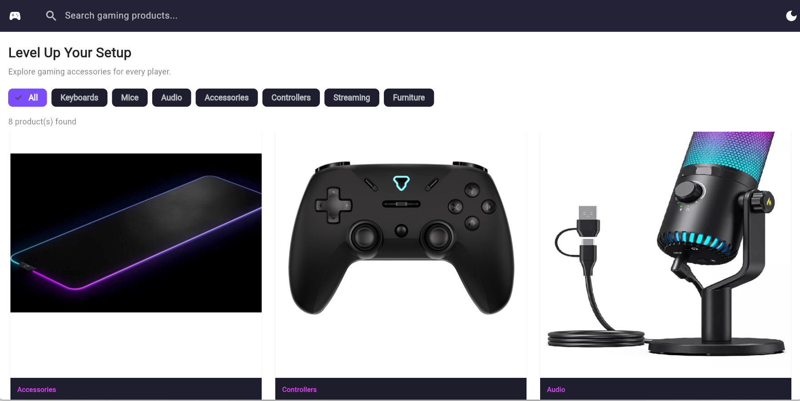
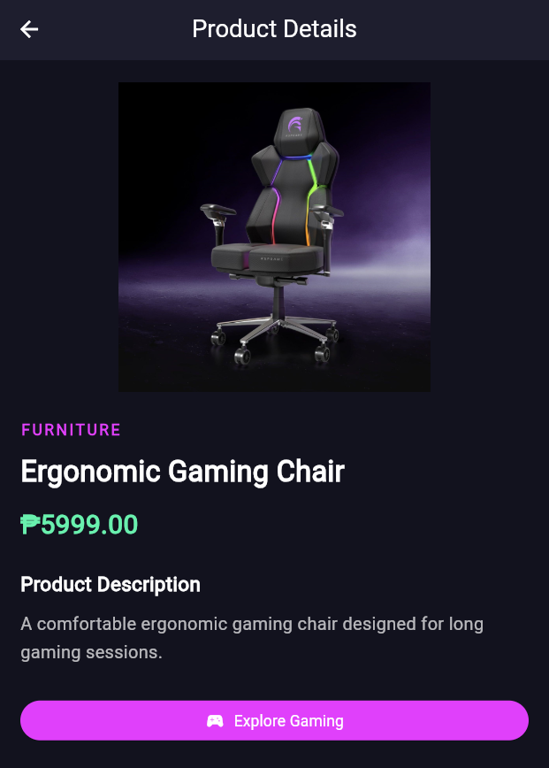
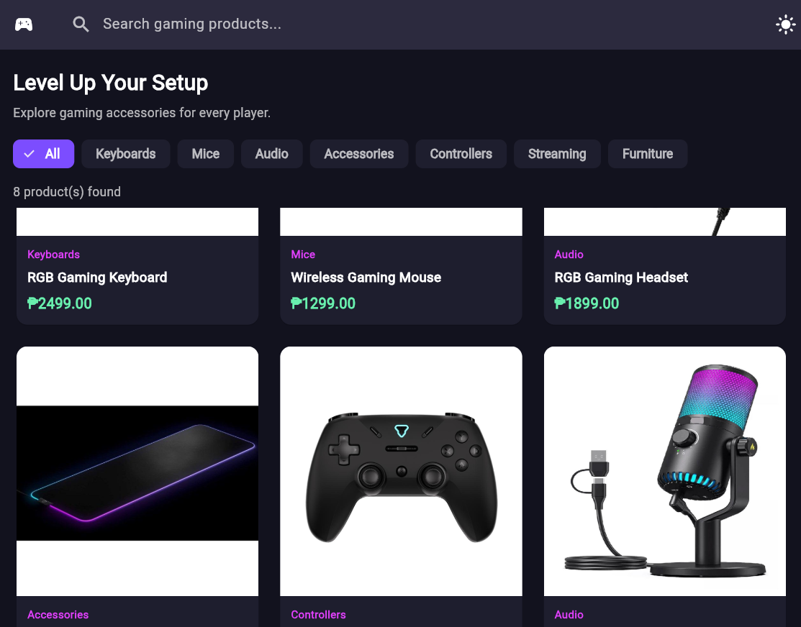

# GAMEHUB – Gaming Accessories Catalog

**Developer:** Reyniel M. Sabordo  
**Course:** Mobile Programming  
**Project:** Lab 02 – Widgets, Layouts, and Material UI  
**Framework:** Flutter  
**Language:** Dart

## Project Description

GAMEHUB is a Flutter-based gaming accessories catalog application that allows users to browse different gaming products. It displays product information such as names, prices, categories, images, and descriptions. The application provides a responsive interface that adapts to mobile, tablet, and desktop screen sizes.

## Features

- Displays eight gaming accessories.
- Responsive mobile, tablet, and desktop layouts.
- Product cards and list tiles.
- Product detail screen with descriptions and prices.
- Light and dark mode toggle.
- Search field that filters products by name.
- Category filter chips.
- Empty search result message when no products match.
- Material Design 3 interface.

## Layout and Responsive Design

GAMEHUB uses a responsive layout to provide a convenient browsing experience across different screen sizes. The application uses a single-column list layout for mobile screens with widths below 600 pixels, a two-column grid layout for tablet screens with widths from 600 to 839 pixels, and a three-column grid layout for desktop screens with widths of 840 pixels and above. The `LayoutBuilder` widget determines the available screen width and automatically selects the appropriate layout. The application also includes a product detail screen, light and dark themes, a search field, and category filters to make browsing gaming accessories easier and more user-friendly.

## Screenshots

### 1. Mobile List Layout

Shows the product catalog in a single-column list layout on a mobile-sized screen.



### 2. Tablet Two-Column Grid Layout

Shows the product catalog arranged in two columns on a tablet-sized screen.



### 3. Desktop Three-Column Grid Layout

Shows the product catalog arranged in three columns on a desktop-sized screen.



### 4. Product Detail Screen

Shows the selected gaming accessory, including its image, name, category, price, and description.



### 5. Dark Mode

Shows the application using its dark theme.



## Reflection

### 1. Why does an Expanded inside a ListView throw an error?

An `Expanded` widget needs a parent with a limited available space to determine how much space it can occupy. However, a `ListView` allows its children to extend in the scrolling direction, resulting in unbounded space. This causes a layout error. To avoid this, I can use a fixed height or another appropriate layout widget.

### 2. What changed in your layout when you used LayoutBuilder instead of MediaQuery, and when would each be the better choice?

`LayoutBuilder` adjusts the layout based on the available space provided by its parent, while `MediaQuery` uses the overall screen dimensions. I used `LayoutBuilder` because it allows GAMEHUB to adjust the product layout depending on the available width. `MediaQuery` is more useful when I need information about the entire screen, such as its dimensions or device settings.

### 3. How did reading colors from the color scheme make the dark theme easier?

Using the app's color scheme makes it easier to maintain consistent colors throughout the application. It also allows colors to adapt when switching between light and dark themes, reducing the need to manually change individual widget colors.

## How to Run the Application

1. Clone or download the repository.
2. Open the project folder in Visual Studio Code.
3. Open the terminal.
4. Install the project dependencies:

   ```bash
   flutter pub get
   ```

5. Run the application in Chrome:

   ```bash
   flutter run -d chrome
   ```

## Testing

Run the following command to execute the widget tests:

```bash
flutter test
```

## Project Structure

```text
catalog_app/
├── assets/
│   └── images/
├── lib/
│   ├── data/
│   ├── models/
│   ├── screens/
│   ├── widgets/
│   └── main.dart
├── screenshots/
│   ├── 01_mobile_list.png
│   ├── 02_tablet_grid.png
│   ├── 03_desktop_grid.png
│   ├── 04_product_detail.png
│   └── 05_dark_mode.png
├── test/
│   └── widget_test.dart
├── pubspec.yaml
└── README.md
```

---
**GAMEHUB – Level Up Your Setup!**
