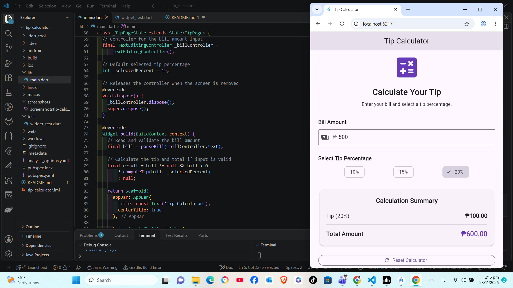

# Hello Flutter: Tip Calculator

**Developer:** Reyn Sabordo

A simple Flutter application that calculates tips and total bill amounts using selectable percentages of 10%, 15%, and 20%.

## Features

- Enter a bill amount.
- Select a tip percentage (10%, 15%, or 20%).
- Automatically calculate the tip and total amount.
- Validate invalid bill inputs.
- Display currency values with two decimal places.
- Reset the calculator.

## Technologies Used

- Flutter
- Dart
- Material 3
- Visual Studio Code

## Application Screenshot



## How to Run

1. Clone this repository.
2. Open the project folder in VS Code.
3. Run `flutter pub get`.
4. Run `flutter run -d chrome`.

## Testing

Run the following commands:

```bash
flutter analyze
flutter test
```
